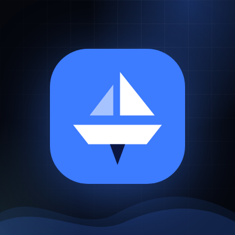

<h1 align="center">Keel</h1>

Fair-launch token launchpad on Base, built on Uniswap v4. <a href="https://keelfun.app">keelfun.app</a> · <a href="https://x.com/Keelfunxyz">@Keelfunxyz</a>

## What it does
- One transaction launches a token: the full supply goes into a Uniswap v4 pool, and the LP is locked forever.
- Supply tiers of 1B / 10B / 100B / 1T, and trade fees of 1 / 2 / 3 / 5 / 10%.
- Fees go to the creator, to holders (claimable ETH), or split across up to 4 wallets.
- Optional anti-snipe: a 90% tax that decays to 0 over 60 seconds. Optional tax-free first buy.
- Swap any Base token (routed via Relay), bridge ETH (Relay), Builders programme, and a Buyback dashboard.

## Base mainnet deployment
| Contract | Address |
|---|---|
| LaunchFactory | `0x736dE2DbC4468F8224c63a11355980fB33949387` |
| LaunchHook | `0x7fA1311D29603211365b34a35eEF99208f06A8CC` |
| LaunchRouter | `0x7c3Afc67Ce06C2bBFEfB580243F6aD01948C0473` |
| PoolManager (Uniswap) | `0x498581fF718922c3f8e6A244956aF099B2652b2b` |

The contracts are unaudited.

## Layout
- `contracts/`: Foundry (Solidity 0.8.26). Run `forge test`. Deploy with `forge script script/Deploy.s.sol --rpc-url <rpc> --broadcast`.
- `api/`: Cloudflare Worker + Durable Object indexer (`keel-api`, api.keelfun.app). Run `npx wrangler deploy`.
- `web/`: Next.js static export served by the `keel-web` Worker (keelfun.app). Build with `npm run build`, then `npx wrangler deploy`.
