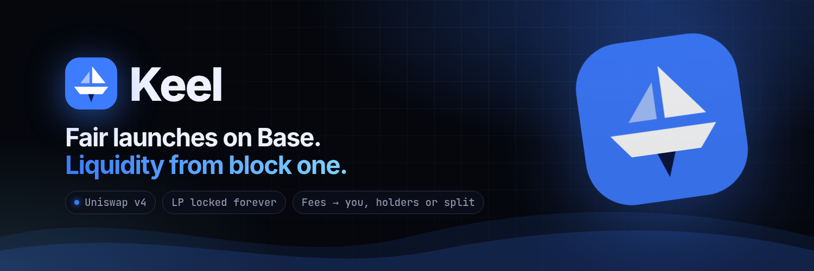
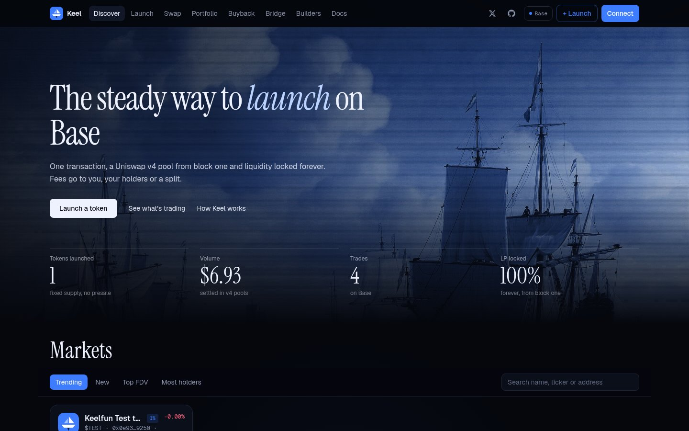
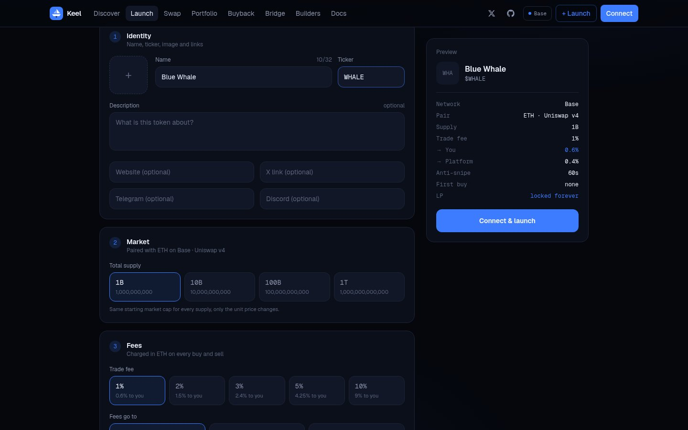
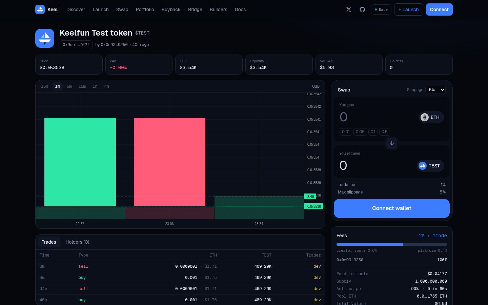
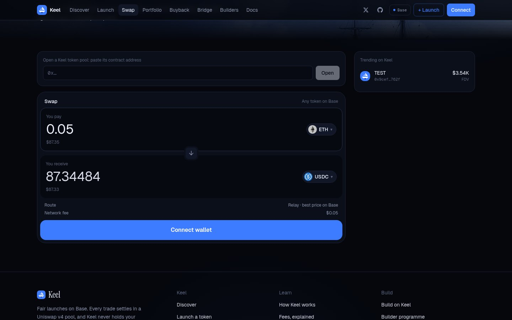
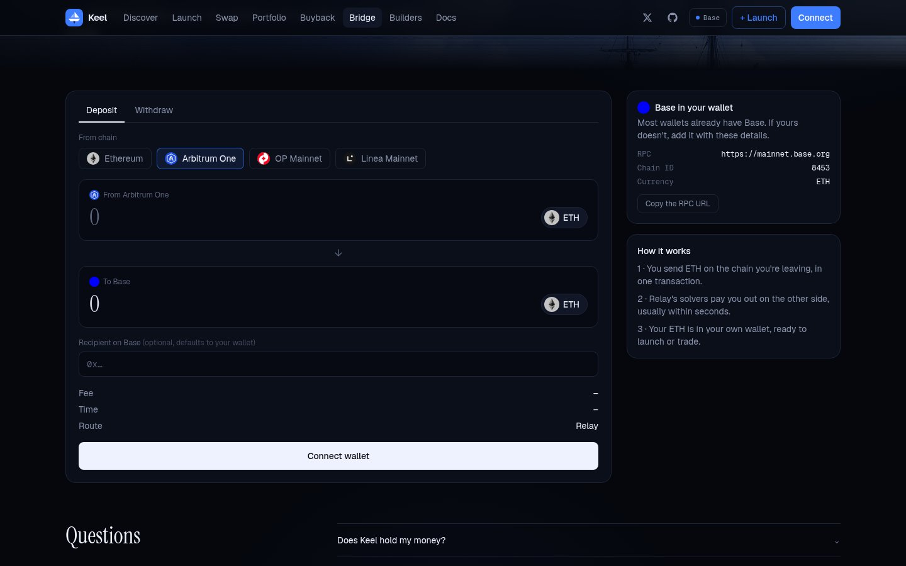
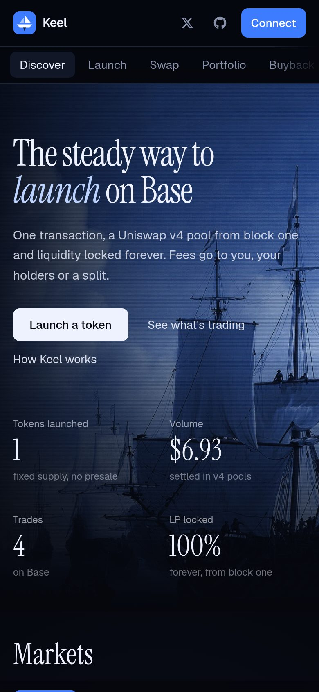

<p align="center">
  
</p>

<p align="center">
  
</p>

<h1 align="center">Keel</h1>

<p align="center">
  <b>The steady way to launch on Base.</b><br/>
  One transaction, a Uniswap v4 pool from block one and liquidity locked forever.
</p>

<p align="center">
  <a href="https://keelfun.app"><b>keelfun.app</b></a> ·
  <a href="https://x.com/Keelfunxyz">X @Keelfunxyz</a> ·
  <a href="https://basescan.org/address/0x736dE2DbC4468F8224c63a11355980fB33949387">Factory on Basescan</a>
</p>

---



## How it works

1. **Launch.** Pick a name, ticker, image and socials, choose a supply and a trade fee, then send one transaction.
2. **Pool.** The factory mints the full supply and puts all of it into an ETH/token Uniswap v4 pool. There is no presale and no team allocation.
3. **Lock.** The factory has no way to remove liquidity, so the LP stays locked forever.
4. **Trade.** Every buy and sell goes through the Keel hook, which takes the trade fee in ETH.
5. **Earn.** The fee goes to the creator, to holders (claimable ETH, split by balance) or to a split of up to 4 wallets. A share goes to the platform.

## Features

| | |
|---|---|
| **Supply tiers** | 1B · 10B · 100B · 1T, fixed forever |
| **Trade fee** | 1% · 2% · 3% · 5% · 10% |
| **Fee routes** | Creator, holders (ETH rewards), or a split across up to 4 wallets |
| **Anti-snipe** | Optional: a 90% tax that decays to 0 over the first 60 seconds |
| **First buy** | Optional, tax-free, in the same launch transaction |
| **Liquidity** | 100% of supply in Uniswap v4, locked forever |
| **Swap** | Any Base token, routed through [Relay](https://relay.link); Keel tokens trade directly against their v4 pools |
| **Bridge** | ETH between Base and Ethereum, Arbitrum, Optimism and Linea through Relay |
| **Builders** | Register a builder code; launches made with `?ref=code` are attributed to you |
| **Buyback** | Dashboard of platform fees set aside for buybacks |

<table>
  <tr>
    <td width="50%"><p align="center">Launch a token</p></td>
    <td width="50%"><p align="center">Token page: chart, trades, swap and fees</p></td>
  </tr>
  <tr>
    <td width="50%"><p align="center">Swap any Base token</p></td>
    <td width="50%"><p align="center">Bridge ETH to Base</p></td>
  </tr>
</table>

<p align="center"></p>

## Contracts (Base mainnet, chain 8453)

| Contract | Address |
|---|---|
| LaunchFactory | [`0x736dE2DbC4468F8224c63a11355980fB33949387`](https://basescan.org/address/0x736dE2DbC4468F8224c63a11355980fB33949387) |
| LaunchHook | [`0x7fA1311D29603211365b34a35eEF99208f06A8CC`](https://basescan.org/address/0x7fA1311D29603211365b34a35eEF99208f06A8CC) |
| LaunchRouter | [`0x7c3Afc67Ce06C2bBFEfB580243F6aD01948C0473`](https://basescan.org/address/0x7c3Afc67Ce06C2bBFEfB580243F6aD01948C0473) |
| Uniswap v4 PoolManager | [`0x498581fF718922c3f8e6A244956aF099B2652b2b`](https://basescan.org/address/0x498581fF718922c3f8e6A244956aF099B2652b2b) |

Deployed at block 59684172. Addresses are also in [`contracts/deployments/8453.json`](contracts/deployments/8453.json).

> **Warning:** The contracts have not been audited. Only trade what you can afford to lose.

## Repository layout

```
contracts/   Foundry project: LaunchToken, LaunchFactory, LaunchHook (v4 hook), LaunchRouter
api/         Cloudflare Worker + Durable Object indexer (SQLite) for tokens, trades, holders and stats
web/         Next.js static frontend, served by a Cloudflare Worker
art/         Logo, X profile picture and banner, OG image (HTML sources included)
scripts/     Local anvil chain and smoke tests
```

## Development

**Contracts**

```bash
cd contracts
forge test
forge script script/Deploy.s.sol --rpc-url https://mainnet.base.org --broadcast --slow --private-key <key>
```

**API** (`api.keelfun.app`)

```bash
cd api
npm install
npx wrangler dev        # local
npx wrangler deploy     # FACTORY, HOOK, START_BLOCK and RPC_URL live in wrangler.jsonc
```

**Web** (`keelfun.app`)

```bash
cd web
npm install
npm run dev
NEXT_PUBLIC_API_URL=https://api.keelfun.app NEXT_PUBLIC_CHAIN_ID=8453 npm run build
npx wrangler deploy
```

Set `NEXT_PUBLIC_CHAIN_ID=84532` to run against Base Sepolia, with your own deployment addresses in `NEXT_PUBLIC_FACTORY`, `NEXT_PUBLIC_HOOK` and `NEXT_PUBLIC_ROUTER`.

## Links

- App: https://keelfun.app
- Docs: https://keelfun.app/docs/
- X: https://x.com/Keelfunxyz
